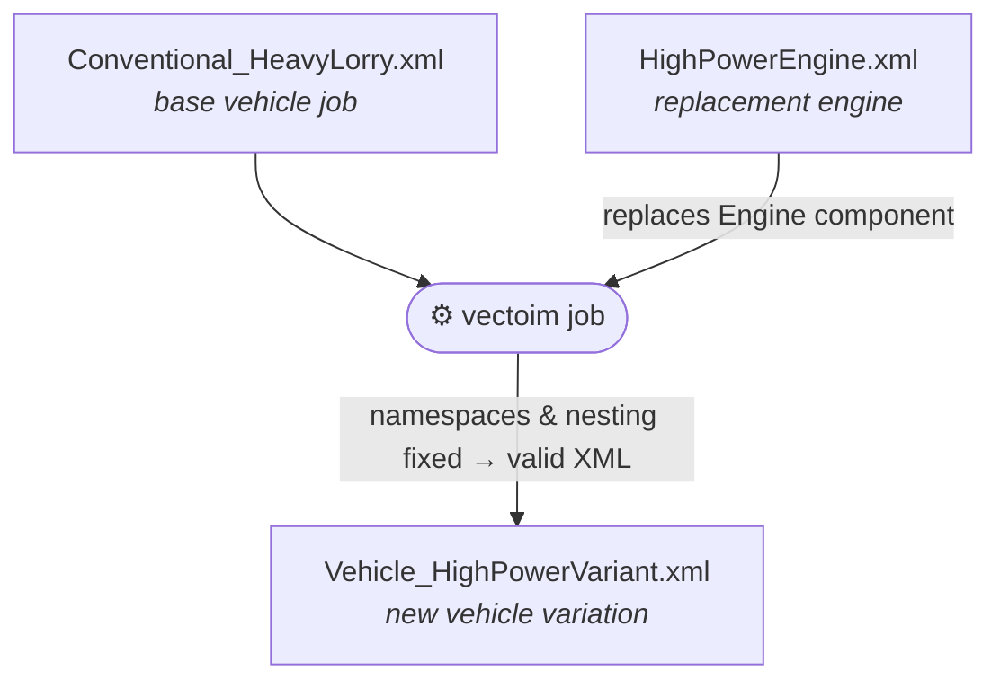
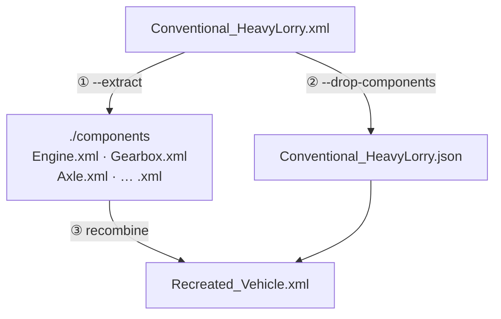
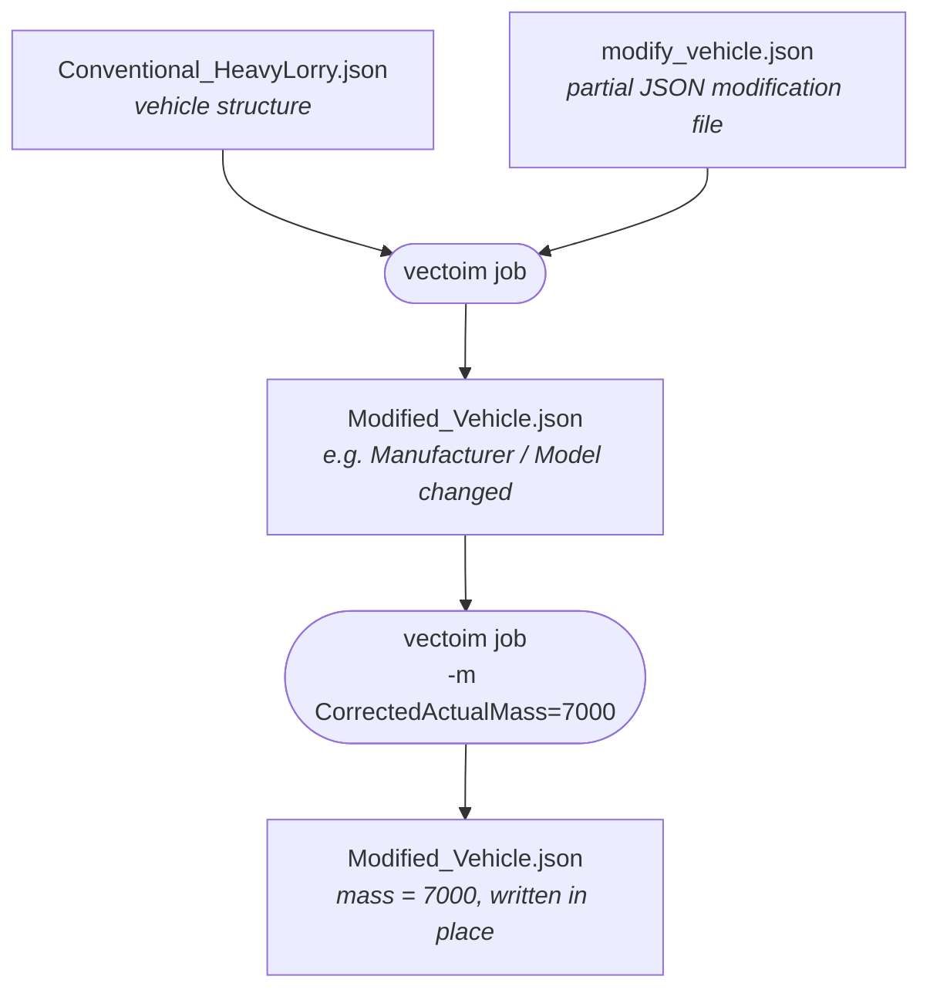

# VECTO Input Manager Showcases

This folder contains demonstration scenarios for the `vectoim` tool, showcasing its key capabilities for working with VECTO vehicle job files.

## Job Creator

### Showcase 1: Engine Change - Creating Vehicle Variations

**Goal:** Show how to create variations of the same vehicle/vehicle structure

**Scenario:** Take a conventional vehicle XML job and replace the engine with a different engine XML component.

**Problem solved:**  Copy-pasting creates issues due to non-fitting namespaces or nesting errors.



**Commands:**

```powershell
vectoim job Conventional_HeavyLorry.xml `
  HighPowerEngine.xml -o Vehicle_HighPowerVariant.xml
```

---

### Showcase 2: XML Component Extraction - JSON Vehicle

**Goal:** Demonstrate that we can "parse" XML to component XMLs and store the vehicle with non-component data in a reusable JSON file

**Scenario:** Take an XML job and "slice it" to:

1. Vehicle-level JSON file (structure without component data)
2. Individual XML component files
3. Then recreate the complete vehicle

**Problem solved:** a) Manually saving valid component xmls out of a job file is a tedious task, b) VECTO xml jobs contain information which are not contained in component xmls which need to be retained to be reused if needed.



**Commands:**

```powershell
# Step 1: Extract components to separate XML files
vectoim job Conventional_HeavyLorry.xml --extract ./components

# Step 2: Convert just the vehicle structure to JSON
vectoim job --drop-components Conventional_HeavyLorry.xml `
  -o Conventional_HeavyLorry.json

# Step 3: Recreate the vehicle
vectoim job Conventional_HeavyLorry.json ./components/*.xml `
  -o Recreated_Vehicle.xml
```

---

### Showcase 3: XML Component Extraction - JSON Vehicle Editing

**Goal:** Show that vehicle JSON and components are modifiable by the tool

**Scenario:** Take the JSON from Showcase 2 and modify both the vehicle properties and specific component values using **partial JSON modification** files.




**Commands:**

```powershell
# Step 1: Extract components to separate XML files
vectoim job Conventional_HeavyLorry.xml -x ./components

# Step 2: Convert just the vehicle structure to JSON
vectoim job --drop-components Conventional_HeavyLorry.xml `
  -o Conventional_HeavyLorry.json

# Step 3: Apply modifications
vectoim job Conventional_HeavyLorry.json modify_vehicle.json `
  -o Modified_Vehicle.json

vectoim job Modified_Vehicle.json `
  -o Modified_Vehicle.json -m CorrectedActualMass=7000

vectoim job Modified_Vehicle.json components/*.xml `
  -o Modified_Vehicle.xml
```

**Partial Modification File:**

- `modify_vehicle.json`: Changes Manufacturer and Model

---

### Showcase 4: PEV E3 to E4 Conversion

**Goal:** Convert an E3 electric vehicle to E4 architecture in a single workflow

**Scenario:** Take an E3 electric vehicle and create an E4 by changing the component type using the `-m` parameter.

**Important Note:** Both `PEV_E3_HeavyLorry.xml` and `PEV_E4_HeavyLorry.xml` jobs
use the same vehicle type (`Vehicle_PEV_HeavyLorryDeclarationType`),
but have different component types:

- E3: `Components_PEV-E3_LorryType`
- E4: `Components_PEV-E4_LorryType`

**Commands:**

```powershell
# Convert E3 to E4 by overriding the Components type
vectoim job PEV_E3_HeavyLorry.xml -o PEV_E4_Converted.xml `
  -m Components=Components_PEV_E4_LorryType_v2_7 `
  -m ArchitectureID=E4 `
  -m Components.ElectricMachine.PowertrainPosition=Item4
```

Expected result: The Retarder and Axle Gear are removed as PEV E4 does not support them.

---

### Showcase 5: XML Component Modification

**Goal:** Modify a specific component value directly in XML files

**Scenario:** Using a partial JSON modification file, modify a specific component and recreate the vehicle.

**Commands:**

```powershell
vectoim job Conventional_HeavyLorry.xml  gearbox_modifications.json `
  -o Modified_Gearbox_Vehicle.xml
```

---

### Showcase 6: Legacy Vehicle Component Migration

**Goal:** Extract components from an older vehicle and put them in a vehicle of the latest VECTO version

**Scenario:** Take components from a vehicle with older version namespaces (v1.0/v2.0) and use them in a new vehicle structure compliant with the latest schema.

**Commands:**

```powershell
# Extract components from older vehicle (xml is the default format, change it with `-X json`)
vectoim job Old_With_Components_2.0.xml -x ./old_components

# Build new vehicle with old components
vectoim job Base_Conventional_2.7.xml ./old_components/*.xml `
  -o Migrated_Vehicle.xml
```

---

### Showcase 7: Interactive Vehicle Change

**Goal:** Show changing vehicle type with interactive auto mode for missing properties

**Scenario:** Convert a Hybrid vehicle to a Conventional vehicle. When required properties are missing from the source, interactive auto mode prompts the user to supply them.

**Commands:**

```powershell
vectoim job HEV_P2_HeavyLorry.xml -t ConvHeavyLorry_v2_7 `
   -o lorry.xml -i auto
```

---

### Showcase 8: Interactive Vehicle from Scratch

**Goal:** Interactively select a vehicle type and properties to build a complete vehicle from scratch

**Scenario:** List available vehicle types, then interactively supply vehicle-specific properties to produce a JSON vehicle-level shell (without components), and finally assemble a completed XML vehicle by combining the JSON with JSON component files.

**Commands:**

```powershell
# List available vehicle types
vectoim job -l

# Interactively create a vehicle-level JSON ()
vectoim job -o shell.json -i vehicle

# Assemble the completed vehicle from the shell and components
vectoim job *.json -o completed_lorry.xml
```

---

## Standard Values

### Showcase 9: Interactive Component Creation

**Goal:** Create a component from scratch by answering interactive prompts, then compute standard values

**Scenario:** Build a battery component interactively, with the tool prompting for each property along with valid ranges and options, then produce the final XML with computed standard values.

**Commands:**

```powershell
# List available standard-value component types
vectoim sv -l

# Create a battery interactively and output to XML
vectoim sv -t battery -o battery.xml -i
```

---

### Showcase 10: Component from JSON Input

**Goal:** Generate a component XML from a pre-filled JSON input file

**Scenario:** Export the input template for an axle component to JSON, fill it in, then produce both XML and JSON output files.

**Commands:**

```powershell
# Export example template
vectoim sv -t axle -e -o axle-input.json

# Generate XML output from the filled input file
vectoim sv axle-input.json -o axle.xml

# Generate JSON output from the filled input file
vectoim sv axle-input.json -o axle.json
```
