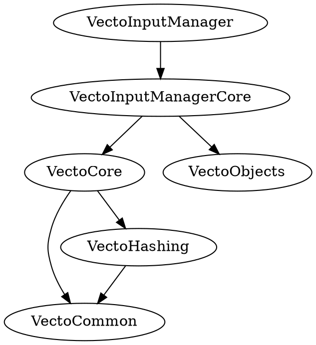
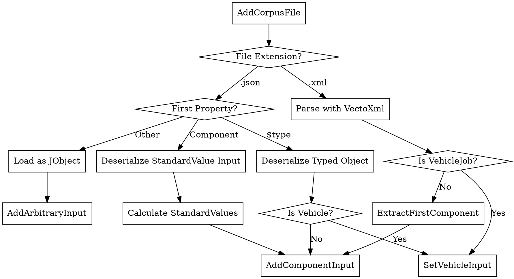
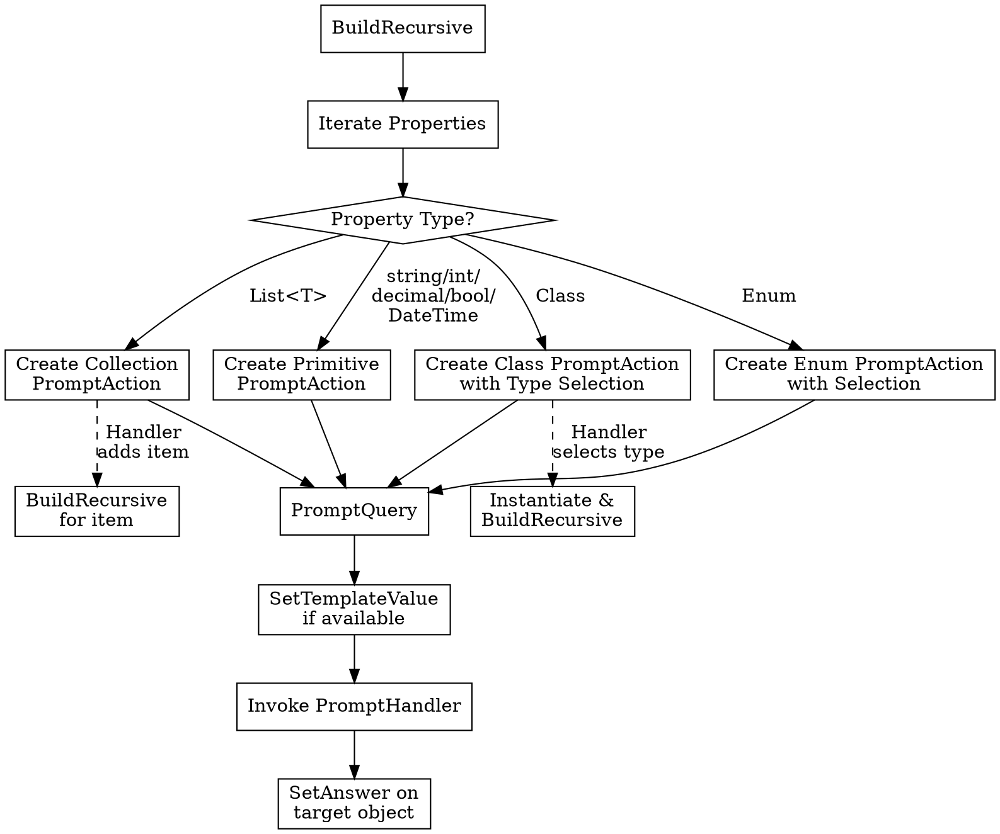
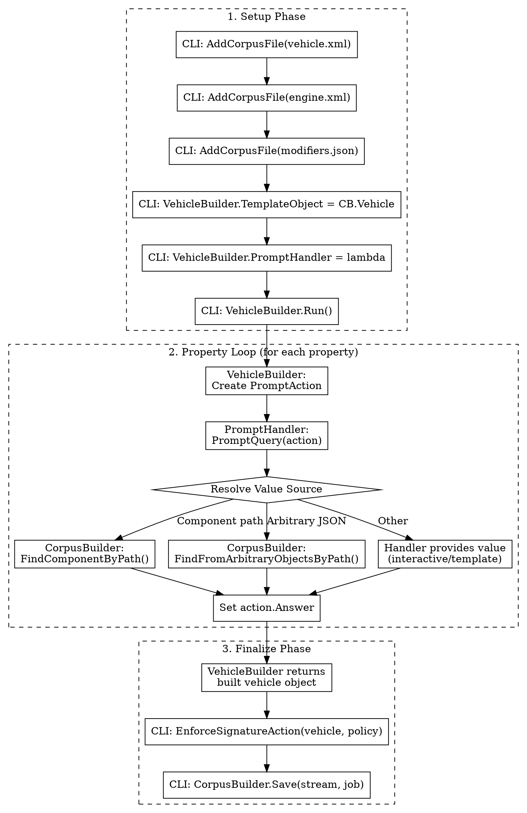

# Architecture Overview

## Project Layout

```txt
VectoInputManager/
- VectoInputManager/          CLI application entry and commands
- VectoInputManagerCore/      Core domain: builders, standard values, JSON/XML utilities
- VectoObjects/               Strongly-typed VECTO schema models and serializers
- VectoInputManagerTests/      Unit and integration tests for CLI and domain
- VectoObjectsTests/          Tests for the VectoObjects model library
- InputSchemas/               JSON schemas for standard value inputs
- ComponentSchemas/           JSON schemas for vehicle components
- VehicleSchemas/             JSON schemas for vehicle types
```

The design is layered to keep user interaction, domain logic, and data models separated. The CLI layer (VectoInputManager) invokes the Core layer (VectoInputManager.Core), which in turn uses the Models layer (VectoObjects). Models are data-only types, Core is UI-agnostic and contains all business logic, while CLI focuses on user experience and orchestration.

What each project is responsible for:

- VectoInputManager/ (CLI): Hosts the `vectoim` executable. Parses arguments, wires DI, and invokes domain operations.
- VectoInputManagerCore/ (Core): Implements all business rules and transformations (extract, standard values generation, job composition, conversions). UI-agnostic.
- VectoObjects/ (Models): Schema-based C# types for VECTO vehicles/components with XML/JSON serialization helpers. Independent and reusable by other tools.
- Tests/ (Both): Validates behaviors end-to-end and at the unit level; includes sample inputs/outputs.

## Project Dependencies



## CLI Command Flows

- `sv` - Standard values

  - Input: JSON file or interactive prompts; resolve component type (auto or explicit)
  - Merge inputs from parameters/prompts/template -> compute standard values
  - Hash and serialize to XML or JSON (by output extension)
  - Validate XML output against schema
  - Write final output path

- `job` - Create/modify/convert/extract-components from job

  - Input: base vehicle + component files (XML/JSON) and/or standard-value inputs
  - Scan inputs -> detect vehicle -> gather values (params/raw JSON/interactive)
  - Merge components and build vehicle -> hash and serialize job (XML/JSON)
  - Generate `.report.txt` with validation and details
  - Write final output and report paths

- `comp` - convert components to XML & JSON

  - Input: XML/JSON file (vehicle or component); ensure output directory
  - Detect type -> optionally remove components (vehicle mode)
  - Serialize to JSON/XML

## Builder Classes

The builder subsystem provides two complementary classes that work together to construct VECTO vehicle jobs from heterogeneous inputs: `CorpusBuilder` manages the collection of input files and maps them to vehicle properties, while `ObjectBuilder` iterates over object graphs and drives the construction process.

### CorpusBuilder

`CorpusBuilder` aggregates and organizes mixed input files (vehicle XML/JSON, component XML/JSON, and arbitrary JSON fragments) into a coherent "corpus" that can be assembled into a final vehicle job.

**Key Responsibilities:**

- **File Ingestion**: Accepts XML and JSON files via `AddCorpusFile()`, automatically detecting whether each is a vehicle, typed component, or arbitrary JSON
- **Component Mapping**: Maps components to well-known vehicle property paths using regex patterns (e.g., `Components.AirDrag`, `Components.ElectricEnergyStorage.Battery[0].REESS`)
- **Signature Validation**: Tracks original component hashes to detect modifications and enforce signature policies (`Block`, `Sign`, `Keep`, `ReSign`, `Clear`)
- **Lookup Services**: Provides `FindComponentByPath()` and `FindFromArbitraryObjectsByPath()` for the prompt handler to resolve property values during vehicle construction
- **Report Generation**: Produces validation reports showing component usage, signature errors, and unused files

**Core Data Structures:**

```csharp
// Wraps an input file with its deserialized object and mapping state
public class CorpusObject {
    public object Object { get; }        // Deserialized vehicle/component/JObject
    public string FileName { get; }       // Source filename
    public string? PropertyPath { get; }  // Target path in vehicle (e.g., "Components.Engine")
    public bool? IsUsed { get; }          // Tracks consumption during build
    public bool ArbitraryObject { get; }  // True for untyped JSON fragments
}
```

**File Detection Flow:**



**Component Mapping Algorithm:**

When `FindComponentByPath()` is called:

1. Parse the path using `WellKnownRegex` to identify component patterns
2. Search unused `CorpusObject` entries for matching type names
3. Assign the first match to the requested path (filename sort order breaks ties)
4. For nested paths (e.g., `Components.Engine.MaxPower`), navigate into the matched component

### ObjectBuilder

`ObjectBuilder` is an abstract base class that recursively walks an object graph, generating `PromptAction` instances for each property that needs a value. A `PromptHandler` callback supplies values for each action—this can be an interactive console prompt, a batch/automated handler that reads from files and templates, or a test harness. The same iteration mechanism powers both interactive and non-interactive modes.

**Key Responsibilities:**

- **Property Iteration**: Reflects over class properties, handling primitives, enums, nested classes, and collections
- **Template Support**: Pre-populates defaults from a `TemplateObject` to minimize required input
- **Type Selection**: For polymorphic properties, determines concrete types (interactively or from template)
- **Validation**: Enforces `RangeAttribute` constraints and handles nullable/optional patterns
- **Recursive Construction**: Instantiates nested objects and builds them depth-first
- **Handler Abstraction**: Delegates value resolution to a `PromptHandler`, enabling both interactive CLI prompts and automated batch processing with the same core logic

**PromptAction Model:**

```csharp
public class PromptAction {
    public string Property { get; }     // Dot-notation path (e.g., "Components.Engine.MaxPower")
    public string Query { get; }        // Human-readable prompt text
    public PromptActionType Type { get; } // String, Integer, Decimal, Boolean, Enum, Class, Collection
    public int Depth { get; }           // Nesting level for UI indentation
    public bool Optional { get; }       // Whether null/skip is allowed
    public IDictionary<string,string>? Selection { get; } // Options for enum/class/collection
    public object? TemplateValue { get; } // Default from template
    public object? Answer { get; set; } // Value provided by handler
}
```

**Property Processing Flow:**



### VehicleBuilder

`VehicleBuilder` extends `ObjectBuilder` for vehicle-specific construction:

- Prompts for vehicle type selection before building (`@VehicleType` pseudo-property)
- Resolves type names to VectoObjects assembly types
- Overrides `BeforePromptHandler()` to integrate with `CorpusBuilder` lookups

**Integration with CorpusBuilder:**



# Value Resolution Order

During vehicle job creation, the prompt handler resolves each property value using these sources in priority order:

1. **Vehicle Type Override** — `CLI [vehicle]` argument
2. **Command-Line Parameters** — `--modify` / `-m` key-value pairs
3. **Arbitrary JSON Objects** — raw (untyped) JSON input files
4. **Corpus Component Lookup** — typed component files from `--input`
5. **Interactive Prompt / Input Vehicle Fallback**
